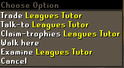
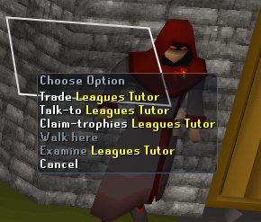
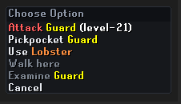
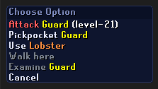
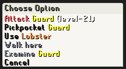
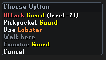
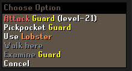

# Right Click Styler

A RuneLite plugin that lets you restyle the right-click menu with your own colours, fonts and themes.

| Normal menu | With Right Click Styler |
| :---: | :---: |
|  |  |

## Built-in themes

| Dark | Midnight | Light | Glass | Classic |
| :---: | :---: | :---: | :---: | :---: |
|  |  |  |  |  |

Classic is the default theme, using the RuneScape Bold font.

## What you can change

| Area | Options |
| --- | --- |
| Colours | Background, border, header, header text, option text, hover, accent |
| Style | Corner radius, opacity, hover style, border, drop shadow, header on or off |
| Text | RuneScape Regular, Small or Bold, Sans or Serif, font size and text shadow |
| Action highlights | Colours and optional bold text for actions such as Attack or Pickpocket |
| Targets | Colours for NPCs, players, items, objects and everything else |
| Combat levels | Keep the game's colours, colour by level difference, or hide levels |
| Themes | Save, rename, duplicate, delete, export and import custom themes |

## Installation

Once Right Click Styler is listed on the Plugin Hub, open RuneLite's configuration panel, open the Plugin Hub, search for **Right Click Styler** and install it.

## Getting started

1. Click the Right Click Styler button in the RuneLite sidebar and select a built-in theme.
2. Expand the editor sections and adjust the appearance. Changes are shown immediately in the preview and in game.
3. To keep changes to a built-in theme, click **Save as…** and create a custom theme. Use **Save** for later changes to that custom theme.

Appearance and theme settings are in the sidebar editor. The **Show sidebar button** setting is in Right Click Styler's normal RuneLite configuration page, where you can restore the button if you hide it. Both Reset controls restore defaults and Classic while preserving saved custom themes. RuneLite's Reset also restores sidebar visibility.

## Compatibility

Interface Styles can remain enabled, but its **High detail menu** must be off and **Menu alpha** must be 255. Otherwise the two plugins can draw conflicting menus.

Right Click Styler keeps the game's native menu width, row positions and click regions. Scrollable menus and menus containing submenus use the normal game appearance. This includes player menus containing submenus created by Interface Styles' condensed player options.

See the [full settings guide](docs/GUIDE.md) for theme sharing, profiles, reset behaviour, advanced settings and troubleshooting.

## License

BSD 2-Clause. See [LICENSE](LICENSE).
