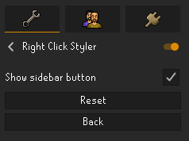

# Settings guide

Most appearance settings are in the Better Right Click panel in the RuneLite sidebar. Sidebar visibility is controlled from Better Right Click's normal RuneLite configuration page.

Classic is selected by default, and every built-in theme uses the RuneScape Bold font by default.

## Getting started

1. Click the Better Right Click button in the RuneLite sidebar.
2. Select Dark, Midnight, Light, Glass or Classic from the theme list.
3. Click an orange section heading to expand it, then adjust the controls. Changes appear immediately in the preview and in game.
4. To keep changes made to a built-in theme, click **Save as…**, enter a name and create a custom theme.
5. Use **Save** when you later edit that custom theme.

Some settings belong to the selected theme and some apply everywhere:

- **Colours**, **Style** and **Text** are part of a theme. Edits are live, but are only kept after you save the custom theme. Built-in edits must be kept with **Save as…**.
- **Action highlights**, **Targets**, **Combat levels** and **Advanced** apply to every theme. These controls save automatically. A global colour is committed when its colour picker closes.

Unsaved theme edits are temporary. They are lost if you discard them, close RuneLite, or switch RuneLite configuration profiles.

## Preview

The preview at the top shows a sample menu drawn with the current theme and settings. Move the mouse over it to see the hover style. When you are logged in, it uses your combat level for the sample combat-level colours.

## Themes

The five built-in themes are protected presets, marked with a lock icon. You can edit their appearance temporarily, but you cannot overwrite, rename or delete them. Your custom themes appear after the built-in themes in the list.

- **Theme list**: selects and activates a theme. Switching themes asks before discarding unsaved edits.
- **Save**: overwrites the selected custom theme with its current edits. It is unavailable for built-in themes and when nothing has changed.
- **Save as…**: saves the current visible appearance as a new custom theme and selects it. Use this to keep edits made to a built-in theme.
- **Revert**: discards unsaved edits and restores the selected theme's saved appearance.
- **More**:
  - **Rename**: renames the selected custom theme.
  - **Duplicate**: makes and selects a copy of the selected theme. Unsaved edits must be discarded first, so the copy uses the selected theme's saved appearance.
  - **Delete**: asks for confirmation, then deletes the selected custom theme and returns to Classic. Any unsaved edits to that theme are also lost.
  - **Export**: copies the current visible appearance to the clipboard as one line of text. It includes unsaved edits but does not save them. The More button briefly shows **Copied!**.
  - **Import**: adds and selects a custom theme from exported text. The input is pre-filled when the clipboard contains text. Unsaved edits must be discarded first.

Importing an existing theme creates a separate custom theme with a new internal identity. Duplicate names are allowed. Invalid or incomplete text is rejected, and no more than 50 custom themes can be saved in one RuneLite profile.

Theme names are limited to 40 characters. Empty names are not accepted.

### Sharing a theme

1. Select the theme and click **More > Export**.
2. Send the copied line of text to another player.
3. They click **More > Import**, paste the complete text and press OK.

## Colours

Click a colour to open the colour picker. These colours are part of the theme and change the working appearance immediately.

- **Background**: the main fill of the menu.
- **Border**: the outline around the menu when Border is enabled in Style.
- **Header**: the fill behind "Choose Option".
- **Header text**: the "Choose Option" text.
- **Option text**: the action text, such as "Attack", when the game has not supplied its own colour and no action highlight applies.
- **Hover**: the fill used by the Fill and Bar hover styles.
- **Accent**: the bar in Bar, the outline in Outline, and the hovered action text in Text.

Hover and action highlights are separate. Hover describes the row under the pointer. Action highlights colour matching action text wherever it appears in a menu drawn by Better Right Click.

Classic uses a brown background, black border and header, brown header text and hover fill, white option text and a yellow accent.

## Style

- **Corner radius**: controls how rounded the menu corners are, from 0 for square corners to 8.
- **Opacity**: controls the background, header fill and Fill or Bar hover fill, from 40 to 100. It does not fade text, borders, accent bars, accent outlines or shadows.
- **Hover style**:
  - **Fill**: fills the hovered row with Hover.
  - **Bar**: uses a Hover fill with an Accent bar on the left.
  - **Outline**: draws an Accent outline around the row.
  - **Text**: changes the hovered action text to Accent.
  - **None**: adds no hover effect.
- **Border**: draws the Border colour around the menu.
- **Drop shadow**: draws a soft shadow beneath the menu.
- **Header**: shows "Choose Option". Hiding it removes the header area while keeping rows aligned with the game's click areas.

Classic defaults to square corners, 100 opacity, Text hover, Border on, Drop shadow off and Header on.

## Text

- **Font**: Regular, Small and Bold are RuneScape's fonts. Sans and Serif are standard scalable fonts. Sans and Serif display runs of extra spaces as a single space.
- **Font size**: ranges from 11 to 13. It only applies to Sans and Serif, so the control is disabled for the RuneScape fonts.
- **Text shadow**: draws a dark shadow behind text.

Classic uses Bold with Text shadow enabled. RuneScape fonts have a fixed size.

## Action highlights

Action highlights change the action text only. They do not change target names, combat levels, menu entries or click behaviour.

- **Enabled**: turns all action highlight rules on or off. It is on by default.
- **Bold**: uses bold text for highlighted actions. It is on by default.
- **Rules**: each row contains a complete action name, a colour and a remove button.
- **+ Add rule**: adds a rule. Up to 50 rules can be saved.

Rules match the complete displayed action name after the game's formatting is removed. Matching ignores capital letters and surrounding spaces, but is not a partial match. For example, `Attack` matches `attack`, but not `Attack player`.

Press Enter or leave the action field to save a changed name. Closing the colour picker saves a changed colour. Blank action names are not saved. If the same action appears more than once in the rules, the last matching rule wins; rule order otherwise has no effect.

The default rules highlight Attack in red and Walk here and Examine in grey. With the Text hover style, Accent temporarily takes precedence over an action's highlight colour while that row is hovered. A highlighted action remains bold if Bold is enabled.

## Targets

The target is the thing an action is used on, such as "Guard" in "Attack Guard".

- **Mode > Game**: keeps the target colours supplied by the game. This is the default.
- **Mode > Custom**: uses the NPC, Player, Item, Object and Other colours below. These colour controls are disabled in Game mode.
- **NPC**, **Player**, **Item**, **Object**: colour those target types.
- **Other**: colours targets that are not recognised as one of those types.

The default custom colours are yellow for NPCs, white for players, orange for items, cyan for objects and white for Other.

## Combat levels

These settings control the `(level-N)` text after NPC and player names independently of the rest of the target.

- **Mode > Game**: keeps the level colour supplied by the game. This is the default.
- **Mode > Custom**: compares the displayed level with your combat level and uses Lower level, Same level or Higher level. These colour controls are disabled outside Custom mode.
- **Mode > Hide**: removes level text while preserving the game's native menu width.

The default custom colours are green for lower levels, yellow for the same level and red for higher levels.

Combat-level mode takes precedence over target mode for the level portion. For example, Custom target colours can colour an NPC name while Custom combat colours independently colour its level. Action highlights affect only the action before the target.

## Advanced

You will not normally need these controls.

- **Text offset X**: sets the space between the menu edge and the text, from 0 to 20. The default is 3, and the same space is reserved on the right.
- **Baseline nudge**: moves text up or down from -10 to 10. The default is 0.
- **Show hit rows**: outlines each native row click area for alignment checking. It is off by default.
- **Reset all settings**: after confirmation, restores Action highlights, Targets, Combat levels and Advanced to their defaults, selects Classic and discards unsaved theme edits. Saved custom themes are preserved.

The menu always keeps the game's native width. Large fonts, long entries or a large Text offset X can therefore clip text instead of widening the menu.

## RuneLite profiles

Better Right Click settings, the active theme and saved custom themes belong to the active RuneLite configuration profile. Switching profiles reloads that profile's independent settings and theme list.

If a theme disappears after a profile switch, switch back to the profile where it was saved or export it there and import it into the new profile. Switching profiles discards unsaved theme edits without a confirmation prompt.

## RuneLite plugin settings

*Sidebar visibility and RuneLite's full configuration reset.*

Use **Show sidebar button** to hide or restore the Better Right Click sidebar button. It is enabled by default. If the button is missing, open Better Right Click in RuneLite's normal configuration panel and enable this setting. **Back** returns to RuneLite's plugin list.

The **Reset** button shown here restores Better Right Click's configuration defaults, selects Classic and restores the sidebar button. Saved custom themes are preserved.

The sidebar's **Advanced > Reset all settings** also restores visual defaults and Classic while preserving saved custom themes, but it does not change sidebar visibility.

## Compatibility and limitations

- Interface Styles can remain enabled if **High detail menu** is off and **Menu alpha** is 255. If either setting conflicts, the sidebar shows a warning and a chat message appears once per Better Right Click plugin session when the conflict is detected while logged in.
- Scrollable menus use the normal game appearance.
- Any menu containing a submenu uses the normal game appearance because the plugin cannot determine whether the submenu is open. Interface Styles' condensed player options can therefore make the whole player menu use native styling.
- Better Right Click preserves the game's menu width, row positions and click regions. It changes appearance only.
- If custom rendering fails, the plugin uses the normal game menu for the rest of that plugin session.

## Troubleshooting

### A menu uses the normal game appearance

Scrollable menus and menus containing submenus are intentionally left to the game. If every ordinary menu remains native after a drawing failure, disable and re-enable Better Right Click to start a new plugin session.

### The normal menu appears beneath a translucent theme

Open Interface Styles, turn off **High detail menu** and set **Menu alpha** to 255. Interface Styles can stay enabled with those compatible settings.

### The sidebar button disappeared

Open Better Right Click in RuneLite's normal configuration panel and enable **Show sidebar button**.

### A theme import fails

Copy and paste the complete exported line. Imports are rejected when the text is invalid or too long, or when the current RuneLite profile already has 50 custom themes.

### Theme edits were not saved

Use **Save** for a custom theme or **Save as…** for edits to a built-in theme. Export includes unsaved edits but does not save them. Closing RuneLite or switching RuneLite profiles discards unsaved edits.

### A theme is missing after switching profiles

Custom themes are profile-specific. Switch back to the original RuneLite profile, or export the theme from that profile and import it into the new one.

### Resetting the plugin

Both **Advanced > Reset all settings** in the sidebar and RuneLite's normal **Reset** restore defaults and Classic while preserving saved custom themes. RuneLite's Reset also restores the sidebar button.
