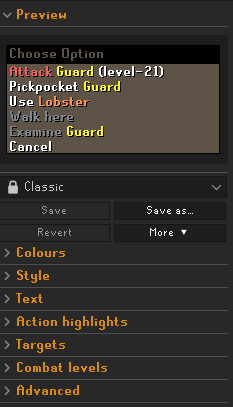
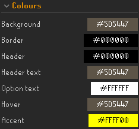
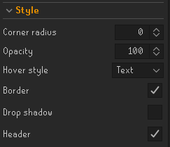
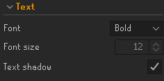
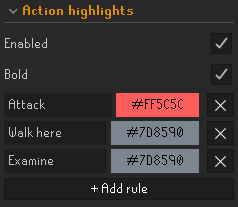
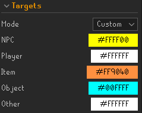
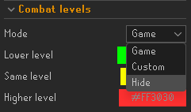
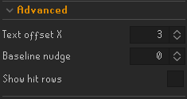

# Settings guide

Everything is set from the Better Right Click panel in the RuneLite sidebar. This guide goes through it from top to bottom.

Classic is selected by default, and every built-in theme uses the RuneScape Bold font by default.

Some settings belong to a theme and some apply everywhere:

- **Colours, Style and Text** are part of the theme. Changes show up straight away in the preview and in game, but they are only kept once you save the theme.
- **Action highlights, Targets, Combat levels and Advanced** apply to every theme and are saved as soon as you change them.

## Preview

The preview at the top shows a sample menu drawn with the current theme and settings, so you can see a change before opening a menu in game. Move the mouse over it to see the hover style. When you are logged in it uses your real combat level for the combat level colours.

## Themes

Below the preview is the theme list and its buttons.

- **Theme list**: picks the active theme. The five built-in themes (Dark, Midnight, Light, Glass and Classic) have a lock icon and can't be changed or deleted. Your own themes are listed after them.
- **Save**: saves your changes to the current theme. It only works on your own themes, and only when there is something to save.
- **Save as...**: saves the current look as a new theme with a name you choose. This is how you keep changes made to a built-in theme.
- **Revert**: throws away unsaved changes and goes back to the saved version of the theme.
- **More**:
  - **Rename**: renames the current theme (your own themes only).
  - **Duplicate**: makes a copy of the current theme.
  - **Delete**: deletes the current theme (your own themes only). If it was active you go back to Classic.
  - **Export**: copies the current visible look to your clipboard as a line of text, including unsaved changes. Exporting does not save those changes. The More button briefly shows "Copied!".
  - **Import**: adds a theme from text someone exported. The box is filled from your clipboard if it holds text. The imported theme is added to your list and selected.

If you have unsaved changes, switching theme, Duplicate and Import ask before throwing them away. You can have up to 50 of your own themes.

### Sharing a theme

1. Select the theme and click **More > Export**.
2. Send the copied text to the other player.
3. They click **More > Import**, paste the text and press OK.

## Colours

Click a colour to change it.

- **Background**: the main fill of the menu.
- **Border**: the outline round the menu, when Border is on in Style.
- **Header**: the fill behind "Choose Option".
- **Header text**: the "Choose Option" text.
- **Option text**: the action text, such as "Attack", when the game doesn't give it a colour of its own.
- **Hover**: the fill used by the Fill and Bar hover styles.
- **Accent**: the bar in the Bar hover style, the outline in the Outline hover style, and the hovered action in the Text hover style.

## Style

- **Corner radius**: how rounded the corners are, from 0 (square) to 8.
- **Opacity**: how solid the background, header and hover fill are, from 40 to 100. Text is always fully solid.
- **Hover style**: how the row under the mouse is shown.
  - **Fill**: the row is filled with the Hover colour.
  - **Bar**: a Hover colour fill with an Accent coloured bar on the left.
  - **Outline**: an Accent coloured outline round the row.
  - **Text**: the action text turns the Accent colour.
  - **None**: no hover effect.
- **Border**: draws an outline round the menu.
- **Drop shadow**: draws a soft shadow under the menu.
- **Header**: shows the "Choose Option" header. With it off the menu starts at the first row, and the rows still line up with the game's click areas.

## Text

- **Font**: Regular, Small and Bold are RuneScape's own fonts. Sans and Serif are standard fonts. With Sans and Serif, extra spaces in menu text are shown as a single space.
- **Font size**: from 11 to 13. Only Sans and Serif can be resized, so this is greyed out for the RuneScape fonts.
- **Text shadow**: draws a dark shadow behind the text, like the game does.

## Action highlights

Highlights colour a specific action wherever it shows up in a menu.

- **Enabled**: turns highlights on or off.
- **Bold**: draws highlighted actions in a bold font.
- **Rules**: each rule is an action and a colour. Type the action exactly as it appears in the menu, such as "Attack" or "Pickpocket". Capital letters don't matter. Click the colour to change it, and the cross to remove the rule.
- **+ Add rule**: adds a new rule. You can have up to 50.

## Targets

The target is the thing an action is used on, such as "Guard" in "Attack Guard".

- **Mode**: **Game** keeps the colours the game uses. **Custom** uses the colours below instead.
- **NPC**, **Player**, **Item**, **Object**: the colour for each type of target.
- **Other**: the colour for any target that isn't one of the above.

## Combat levels

These settings are for the "(level-N)" text after NPC and player names.

- **Mode**:
  - **Game**: keeps the game's colour.
  - **Custom**: colours the level by how it compares to your own combat level.
  - **Hide**: removes the level text. The menu keeps the game's native width.
- **Lower level**, **Same level**, **Higher level**: the colours used in Custom mode.

## Advanced

You won't normally need these.

- **Text offset X**: the space between the menu edge and the text, from 0 to 20. The same space is kept on the right.
- **Baseline nudge**: moves the text up or down by a few pixels, from -10 to 10, if it doesn't look centred in the rows.
- **Show hit rows**: draws an outline round each row's click area. Useful for checking the rows line up with where clicks land.
- **Reset all settings**: puts the Action highlights, Targets, Combat levels and Advanced settings back to their defaults and switches to the Classic theme, dropping any unsaved theme changes. It asks first, and your saved themes are kept.

## Things to know

- **Interface Styles' "High detail menu" and "Menu alpha" settings can conflict with this plugin.** While Interface Styles is on with High detail menu enabled or Menu alpha set below 255, the panel shows a warning at the top, and you get a chat message once after logging in. Turn off High detail menu and set Menu alpha to 255, or turn off Interface Styles, for themes to work.
- You can hide the sidebar button with **Show sidebar button** in the plugin's settings in the RuneLite configuration panel. Turn it back on to get the panel back.
- The plugin only changes how the menu looks. The game still decides what is in the menu and what each click does.
- The custom menu uses the game's native width and row positions. The plugin does not change the game's click regions.
- Scrollable menus and menus that contain a submenu are drawn by the game as normal. Interface Styles' condensed player options therefore keep their normal submenu appearance.
- If the menu ever fails to draw, the plugin switches to the normal game menu for the rest of the session instead of leaving you without one.
